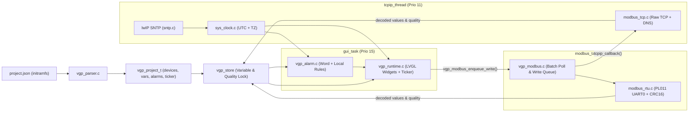

# P0 監控系統核心功能開發規格書（EGM Spec）

| 項目 | 內容 |
| :--- | :--- |
| **文件狀態** | Implemented v1.0（ARM 編譯與靜態驗證通過，待實機聯調） |
| **適用專案** | `pi-zero-w-ucos2-wifi`（Raspberry Pi Zero W / Zero 2 W，µC/OS-II V2.93.01 + LVGL 9.4.0 + lwIP 2.2.1） |
| **上游規格來源** | `InfoSys_ViewGP_Web`（`src/model.ts`、`src/services/globalAlarms.ts`、`docs/Modbus-設備通訊規格.md`） |
| **涵蓋範圍（P0）** | ① Modbus 設備通訊（TCP / RTU）與標籤映射　② 警報引擎（全域 Word 警報、元件級條件警報、警報清單與跑馬燈）　③ 真實時間同步（SNTP 網路校時 + `datetime` 格式化） |
| **編譯約束** | Freestanding C11（`-nostdlib -Wall -Wextra -Werror -Wstrict-prototypes -Wmissing-prototypes -DLV_DISABLE_API_MAPPING`），Kernel + `.bss` + `.stacks` 總計不可超過 `linker.ld` 之 16 MiB（`0x00008000`–`0x01000000`） |

---

## 1. 背景、目標與非目標（Scope & Non-Goals）

### 1.1 背景與目標
本專案在 Raspberry Pi Zero W（BCM2835）與 Zero 2 W（BCM2837 AArch32）上執行 ViewGP HMI 監控畫面（由 `InfoSys_ViewGP_Web` 設計並匯出 `project.json`）。目前僅支援離線記憶體變數與靜態畫面渲染。

P0 階段目標為補齊**工業監控系統運作必備的三項核心能力**，使 Pi Zero 能獨立連接現場 PLC／感測器、即時觸發與顯示警報，並提供準確的系統時間：
1. **Modbus 通訊引擎**：解析 `devices[]` 與 `variables[].modbus`，透過 Wi-Fi（Modbus TCP）或 PL011 UART（Modbus RTU）輪詢設備、執行安全寫入與讀回確認，並管理標籤資料品質（`waiting / good / bad`）。
2. **警報系統**：解析 `alarmAreas[]`、`alarmTicker` 與元件 `alarmRules[]`，即時評估全域 16-bit Word 位元警報（含遮罩）與元件門檻警報，驅動警報清單表格（支援確認 ACK）與頂部／底部跑馬燈。
3. **SNTP 時間同步**：複用既有 `vendor/lwip/src/apps/sntp/sntp.c`，於 Wi-Fi 取得 IP 後自動校時，提供 UTC+時區偏移之真實時鐘給 `datetime` 元件與警報時間戳。

### 1.2 明確非目標（Non-Goals）
- **不包含 SD 卡寫入與歷史持久化**（警報歷史與事件僅存於 RAM 環形緩衝區，重開機重置；FATFS 屬於 P3）。
- **不包含 P1 遺漏 HMI 元件**（`image`、`slider`、`arc`、`spinbox`、`dropdown`、背景 `trend` 等將於 P1 處理）。
- **不啟用 lwIP Socket / Netconn API**（維持 `LWIP_SOCKET=0`、`LWIP_NETCONN=0`，所有網路操作均以 Raw API 執行於 `tcpip_thread`）。
- **不支援同串列埠多站 RTU 輪詢**與 **RTU 站號 0 廣播寫入**（與上游 `Modbus-設備通訊規格.md` 一致）。

---

## 2. 系統架構與執行緒所有權（Architecture & Concurrency）

### 2.1 既有任務與新增任務配置
現有 µC/OS-II 任務（`OS_MAX_TASKS = 16`，`OS_LOWEST_PRIO = 31`）：

| 優先權 | 任務名稱 | 職責 | 備註 |
| :---: | :--- | :--- | :--- |
| 5 | `high_task` | 搶佔自檢與每秒狀態回報 | 既有 |
| 8 | `WHD` | CYW4343x Wi-Fi 驅動 | 既有 |
| 10 | `uart_task` | 除錯串列埠指令（`s/+/-/r`） | 若專案啟用 Modbus RTU，自動暫停讓出 UART0 |
| 11 | `tcpip_thread` | lwIP 核心、DHCP、DNS、**SNTP、Modbus TCP Raw API** | **唯一可呼叫 lwIP Raw API 之任務** |
| 12 | `network_task` | Wi-Fi 連線狀態機、啟動/停止 SNTP 與通知 Modbus TCP 連線狀態 | 既有 |
| 13 | `usb_keyboard_task` | DWC2 USB Host + HID 鍵盤輪詢 | 既有 |
| **14** | **`modbus_task`（新增）** | 設備輪詢排程、Modbus RTU 序列收發、派發 TCP 讀寫給 `tcpip_thread`、寫入請求佇列處理 | Stack 4096 words（16 KiB） |
| 15 | `gui_task` | LVGL 渲染、`vgp_runtime_update()`、**警報引擎評估**、使用者輸入 | **唯一可呼叫 LVGL API 之任務** |
| 20 | `low_task` | 背景負載自檢 | 既有 |

### 2.2 模組資料流架構



### 2.3 同步與鎖定不變量（Concurrency Invariants）
1. **嚴格單一擁有者**：
   - 僅 `gui_task` 可呼叫 `lv_*()`。
   - 僅 `tcpip_thread` 可呼叫 lwIP Raw API（`tcp_*`, `udp_*`, `dns_*`, `sntp_*`）。
2. **共享變數保護（`OS_ENTER_CRITICAL` / 短臨界區）**：
   - `vgp_variable_t` 之即時值（`val_num`, `val_bool`, `val_str`）、資料品質（`quality`）與最後更新時間（`updated_ms`）之讀寫，皆透過 `vgp_var_read_snapshot()` / `vgp_var_write_from_comm()` 在關中斷短臨界區內複製（單一變數 < 1 µs），**不持有互斥鎖跨越 I/O 或網路等待**，徹底杜絕死鎖與優先權反轉。
3. **寫入解耦（Non-blocking UI → Comm）**：
   - `gui_task` 觸發按鈕／開關／輸入寫入映射變數時，**絕不阻塞等待 Modbus 回應**，而是呼叫 `vgp_modbus_enqueue_write(var_idx, val)` 寫入固定長度佇列（`VGP_MB_WRITE_Q_LEN = 16`），由 `modbus_task` 依序序列化送出並讀回確認。

---

## 3. 資料模型擴充與 JSON 解析規格（`vgp_model.h` / `vgp_parser.c`）

### 3.1 容量常數與靜態記憶體預算
為控制 `.bss` 維持在 `linker.ld` 16 MiB 上限內，定義以下靜態上限（可依需求調整）：

| 常數名稱 | 建議值 | 說明 |
| :--- | :---: | :--- |
| `VGP_MAX_DEVICES` | `8` | 最多同時設定 8 台 Modbus 設備（TCP 或 RTU） |
| `VGP_MAX_VARIABLES` | `128` | 由 64 提升至 128，滿足中小型監控專案 |
| `VGP_MAX_ALARM_AREAS` | `16` | 全域 Word 警報區上限（每區最多 16 bits） |
| `VGP_MAX_WORD_RULES_PER_AREA` | `16` | 每區對應 16-bit Word（bit 0–15） |
| `VGP_MAX_LOCAL_ALARM_RULES` | `64` | 全專案元件級 `alarmRules[]` 總池上限 |
| `VGP_MAX_ALARM_EVENTS` | `64` | RAM 內保留之作用中／歷史警報事件上限 |

**預估新增 `.bss` 總量**：約 `48 KiB`（含設備表、警報規則池、警報事件表與 Modbus 封包緩衝區），對 16 MiB RAM 影響極小（< 0.3%）。

### 3.2 新增資料結構定義

```c
/* --- 資料品質 --- */
typedef enum {
    VGP_QUAL_INTERNAL = 0, /* 非 Modbus 映射之內部變數，恆有效 */
    VGP_QUAL_WAITING,      /* 已映射，等待首次讀取成功 */
    VGP_QUAL_GOOD,         /* 最近一次讀取成功 */
    VGP_QUAL_BAD           /* 設備停用、斷線、逾時、解碼錯誤或 NaN/Inf */
} vgp_quality_t;

/* --- Modbus 設備 --- */
typedef enum {
    VGP_MB_TRANSPORT_TCP = 0,
    VGP_MB_TRANSPORT_RTU
} vgp_mb_transport_t;

typedef enum {
    VGP_MB_PARITY_NONE = 0,
    VGP_MB_PARITY_EVEN,
    VGP_MB_PARITY_ODD
} vgp_mb_parity_t;

typedef enum {
    VGP_DEV_STATE_DISABLED = 0,
    VGP_DEV_STATE_UNMAPPED,
    VGP_DEV_STATE_CONNECTING,
    VGP_DEV_STATE_CONNECTED,
    VGP_DEV_STATE_ERROR
} vgp_dev_state_t;

typedef struct {
    char id[VGP_MAX_ID_LEN];
    char name[VGP_MAX_NAME_LEN];
    bool enabled;
    vgp_mb_transport_t transport;
    uint8_t unit_id;          /* TCP: 0..255, RTU: 1..247 */
    uint32_t poll_interval_ms;/* 100..60000 */
    uint32_t timeout_ms;      /* 100..10000 */
    /* TCP */
    char host[64];
    uint16_t port;            /* default 502 */
    /* RTU */
    char serial_port[32];
    uint32_t baud_rate;       /* 1200..115200 */
    vgp_mb_parity_t parity;
    uint8_t stop_bits;        /* 1 or 2 */
    /* Runtime status */
    vgp_dev_state_t state;
    uint32_t last_success_ms;
    uint32_t error_count;
    char last_error[48];
} vgp_device_t;

/* --- 變數 Modbus 映射 --- */
typedef enum {
    VGP_MB_AREA_COIL = 0,
    VGP_MB_AREA_DISCRETE_INPUT,
    VGP_MB_AREA_HOLDING_REG,
    VGP_MB_AREA_INPUT_REG
} vgp_mb_area_t;

typedef enum {
    VGP_MB_TYPE_BOOL = 0,
    VGP_MB_TYPE_UINT16,
    VGP_MB_TYPE_INT16,
    VGP_MB_TYPE_UINT32,
    VGP_MB_TYPE_INT32,
    VGP_MB_TYPE_FLOAT32
} vgp_mb_datatype_t;

typedef struct {
    bool enabled;
    int16_t device_idx;       /* 解析後快取之 devices[] 索引，-1 表無效 */
    char device_id[VGP_MAX_ID_LEN];
    vgp_mb_area_t area;
    uint16_t address;         /* 0-based (0..65535; 32-bit max 65534) */
    vgp_mb_datatype_t data_type;
    bool low_word_first;      /* false = highFirst, true = lowFirst */
    double scale;             /* default 1.0 */
    double offset;            /* default 0.0 */
    bool writable;            /* access == "readWrite" 且非唯讀區 */
} vgp_modbus_map_t;
```

`vgp_variable_t` 擴充欄位：
```c
    vgp_modbus_map_t modbus;
    vgp_quality_t quality;
    uint32_t updated_ms;
    bool write_failed;        /* 最近一次寫入未能確認旗標 */
```

警報與跑馬燈結構：
```c
typedef enum {
    VGP_SEV_INFO = 0,
    VGP_SEV_WARNING,
    VGP_SEV_CRITICAL
} vgp_severity_t;

typedef enum {
    VGP_OP_GT = 0, VGP_OP_GTE, VGP_OP_LT, VGP_OP_LTE,
    VGP_OP_EQ, VGP_OP_NE, VGP_OP_TRUE, VGP_OP_FALSE
} vgp_alarm_op_t;

typedef enum {
    VGP_ALARM_SRC_LOCAL = 0,
    VGP_ALARM_SRC_GLOBAL,
    VGP_ALARM_SRC_ALL
} vgp_alarm_src_t;

typedef struct {
    char id[VGP_MAX_ID_LEN];
    uint8_t bit;              /* 0..15 */
    char message[96];
    vgp_severity_t severity;
    bool enabled;
} vgp_word_alarm_rule_t;

typedef struct {
    char id[VGP_MAX_ID_LEN];
    char name[VGP_MAX_NAME_LEN];
    char variable_id[VGP_MAX_ID_LEN];
    char mask_variable_id[VGP_MAX_ID_LEN];
    char group[48];
    uint32_t update_interval_ms;
    bool enabled;
    uint8_t num_rules;
    vgp_word_alarm_rule_t rules[VGP_MAX_WORD_RULES_PER_AREA];
    uint32_t last_check_ms;
} vgp_alarm_area_t;

typedef struct {
    char id[VGP_MAX_ID_LEN];
    char message[96];
    char variable_id[VGP_MAX_ID_LEN];
    vgp_alarm_op_t op;
    double threshold;
    vgp_severity_t severity;
    bool enabled;
} vgp_local_alarm_rule_t;

typedef struct {
    bool enabled;
    bool position_bottom;     /* false = "top", true = "bottom" */
    uint32_t interval_ms;     /* 1000..60000, default 3000 */
} vgp_alarm_ticker_t;
```

`vgp_element_t` 擴充欄位（供 `VGP_KIND_ALARM` 使用）：
```c
    uint16_t alarm_rule_start;
    uint16_t num_alarm_rules;
    uint8_t  alarm_max_rows;
    vgp_alarm_src_t alarm_source;
    char     alarm_group[48];
```

### 3.3 `vgp_parser.c` 解析擴充
1. 頂層新增解析鍵：`"devices"`、`"alarmAreas"`、`"alarmTicker"`。
2. `variables[]` 物件新增解析鍵：`"modbus"`（巢狀物件：`deviceId`, `area`, `address`, `dataType`, `wordOrder`, `scale`, `offset`, `access`）。
3. `elements[]` 物件新增解析鍵：`"alarmRules"`、`"alarmMaxRows"`、`"alarmSource"`、`"alarmGroup"`。
4. 解析完成後執行 `vgp_link_project(proj)`：
   - 將每個 `var->modbus.device_id` 對應為 `device_idx`；強制將 `discreteInput` / `inputRegister` 之 `writable` 設為 `false`。
   - 依 `modbus.enabled` 初始化 `var->quality`（未映射為 `VGP_QUAL_INTERNAL`，已映射且設備啟用為 `VGP_QUAL_WAITING`，設備停用為 `VGP_QUAL_BAD`）。

---

## 4. 功能一：Modbus 設備通訊規格

### 4.1 編解碼核心（`modbus_codec.c`，純函式、可 Host 單元測試）
嚴格對齊上游 `docs/Modbus-設備通訊規格.md`：
- **Word 位元組序**：每個 16-bit 暫存器採 Big-Endian（網路位元組序）。
- **32-bit Word 序**：`highFirst`（預設）= `[reg0_hi, reg0_lo, reg1_hi, reg1_lo]`；`lowFirst` = `[reg1_hi, reg1_lo, reg0_hi, reg0_lo]`。
- **資料換算**：
  - 讀取：`display_val = raw_val * scale + offset`；若 `float32` 解碼為 `NaN` 或 `Inf`（使用位元遮罩 `(u32 & 0x7F800000u) == 0x7F800000u` 判斷，不依賴 `libm`），該標籤標記 `VGP_QUAL_BAD`。
  - 寫入：`raw_val = (display_val - offset) / scale`。整數型別（`uint16/int16/uint32/int32`）須檢查範圍且與最近整數誤差 ≤ `1e-7`，否則拒絕寫入並回傳錯誤。
- **功能碼支援**：
  - 讀取：`0x01`（Read Coils）、`0x02`（Read Discrete Inputs）、`0x03`（Read Holding Registers）、`0x04`（Read Input Registers）。
  - 寫入：`0x05`（Write Single Coil，`0xFF00` / `0x0000`）、`0x06`（Write Single Register，16-bit）、`0x10`（Write Multiple Registers，32-bit 2 words）。
- **例外碼處理**：若回應功能碼最高位元為 `1`（`fc | 0x80`），解析例外碼（`0x01`–`0x0B`），記錄 `last_error` 並標記失敗。
- **CRC-16/Modbus（供 RTU）**：多項式 `0xA001`、初值 `0xFFFF`，低位元組在前。

### 4.2 批次合併演算法（Batch Coalescing）
針對每台啟用設備，於專案載入時預先建立靜態讀取批次表（`vgp_mb_batch_t`，最多 64 筆）：
1. 依 `(area, address)` 排序該設備的所有映射變數。
2. 同 `area` 中，若下一標籤的 `address <= current_batch_end`（相鄰或重疊，**不跨未映射間隙**），且合併後總量 ≤ 上限（Coil/Discrete Input 為 `2000` bits；Register 為 `125` words），則併入同一批次。
3. 32-bit 標籤（佔 2 words）保證完整納入同一批次，絕不拆開。

### 4.3 Modbus TCP 傳輸層（`modbus_tcp.c`，執行於 `tcpip_thread`）
- **lwIP 設定調整（`net/lwipopts.h`）**：
  - `MEMP_NUM_TCP_PCB` 由 `6` 調高至 `16`（支援 Echo Server + 最多 8 台 Modbus TCP 設備並存與 TIME_WAIT 緩衝）。
- **連線與交換流程**：
  1. `modbus_task` 透過 `tcpip_callback()` 發起單次請求（附帶 `OS_EVENT *done_sem`），在 `modbus_task` 等待 `done_sem`（逾時時間 `dev->timeout_ms`）。
  2. `tcpip_thread` 若該設備尚未連線，先判斷 `host` 是否為 IPv4 字串（`ip4addr_aton`）；若為網域名稱則呼叫 `dns_gethostbyname()` 解析，再呼叫 `tcp_connect()` 建立長連線（TCP Keep-alive / 連線複用）。
  3. 封裝 MBAP 表頭（7 bytes：`tx_id` 遞增、`proto_id = 0`、`length = 1 + pdu_len`、`unit_id`）+ PDU，呼叫 `tcp_write()` + `tcp_output()`。
  4. `tcp_recv` 回呼處理 TCP 分段接收（累積至讀滿 7-byte MBAP 再讀滿 `length - 1` bytes PDU），驗證 `tx_id`、`proto_id == 0`、`unit_id` 與回應長度。
  5. 若發生逾時、連線重置或協定錯誤：關閉並釋放該設備 `tcp_pcb`，該設備所有映射標籤改為 `VGP_QUAL_BAD`，下次輪詢自動重連。

### 4.4 Modbus RTU 傳輸層（`modbus_rtu.c`，執行於 `modbus_task`）
- **硬體選擇說明**：Raspberry Pi Zero W / Zero 2 W 之 Mini UART（UART1）不支援硬體同位元檢查（Parity），因此 Modbus RTU 必須使用 **PL011 UART0（GPIO14 TXD0 / GPIO15 RXD0）**。
- **共存策略**：
  - 若 `project.json` 中**沒有啟用的 RTU 設備**：UART0 維持 115200 8N1 除錯終端，完全不影響現有行為。
  - 若有啟用的 RTU 設備：`uart_configure_rtu(baud, parity, stop_bits)` 重新設定 PL011 `IBRD/FBRD/LCRH`（支援 `1200..115200`、`none/even/odd`、`1/2` stop bits），並設定旗標暫停 `uart_task` 與 `uart_puts` 除錯輸出，避免終端文字污染 RS-485 匯流排。
  - 選配 RS-485 方向控制（DE/RE GPIO）：預留 `MODBUS_RTU_DE_GPIO` 編譯期常數（預設未啟用，接自動流向控制模組即可直接使用）。
- **訊框接收**：送出 `[unit_id][pdu][crc_lo][crc_hi]` 後等待回應，使用 3.5 字元靜默時間（`t35_us = max(1750, 38500000 / baud)`）或依功能碼計算預期回應長度判斷幀結束，驗證站號與 CRC-16。

### 4.5 寫入與安全讀回（Write & Read-Back）
嚴格遵循上游安全規範：
1. UI 端（`button` / `switch` / `input`）操作映射變數時，**不直接覆寫 `vgp_variable_t` 顯示值**，而是檢查 `var->modbus.writable && var->quality == VGP_QUAL_GOOD` 後投入寫入佇列。
2. `modbus_task` 優先處理寫入佇列（插隊於下一輪輪詢之前）：
   - 依型別送出 FC `0x05` / `0x06` / `0x10`。
   - 寫入成功後，立即執行一次單一標籤讀取（Read-Back），將實際讀回值寫入 `vgp_variable_t`。
   - 若寫入或讀回失敗：**不自動重送**，設定 `var->write_failed = true` 並於底部狀態列顯示 `Write unconfirmed: <var_name>`，待下次操作或輪詢成功後清除警示。

---

## 5. 功能二：警報系統規格（`vgp_alarm.c`）

### 5.1 警報事件資料結構
```c
typedef enum {
    VGP_CLR_NONE = 0,
    VGP_CLR_NORMAL,   /* 條件恢復正常 */
    VGP_CLR_MASKED,   /* 被遮罩 Word 遮蔽 */
    VGP_CLR_DISABLED  /* 區域或規則停用 */
} vgp_clear_reason_t;

typedef struct {
    bool used;
    bool is_global;              /* true = alarmAreas, false = element alarmRules */
    uint16_t source_idx;         /* area_idx 或 element_idx */
    uint16_t rule_idx;
    char group[48];
    char message[96];
    vgp_severity_t severity;
    uint32_t raised_epoch;       /* UNIX 秒（校時後）或開機秒數 */
    uint32_t cleared_epoch;      /* 0 表示仍作用中（Active） */
    vgp_clear_reason_t clear_reason;
    bool acknowledged;
} vgp_alarm_event_t;
```

### 5.2 評估規則（於 `gui_task` 每 250ms 週期執行 `vgp_alarm_evaluate(now_ms)`）
1. **全域 Word 警報（`alarmAreas[]`）**：
   - 若 `now_ms - area->last_check_ms < area->update_interval_ms` 跳過。
   - 若 `variableId` 或 `maskVariableId` 的資料品質為 `VGP_QUAL_BAD` 或 `VGP_QUAL_WAITING`：**暫停該區判斷並保留現有作用中警報**（避免斷線誤消警）。
   - 檢查數值為 `0..65535` 整數；對每條規則計算 `masked = (mask & (1u << rule.bit)) != 0`、`triggered = area.enabled && rule.enabled && !masked && ((word & (1u << rule.bit)) != 0)`。
   - 狀態轉移：`!active && triggered` → 新增事件；`active && !triggered` → 填入 `cleared_epoch` 與 `clear_reason`。
2. **元件級條件警報（`alarmRules[]`）**：
   - 跳過品質非 `GOOD/INTERNAL` 之變數。
   - 依 `op`（`gt/gte/lt/lte/eq/ne/true/false`）評估變數與 `threshold`，同樣維護觸發／恢復狀態轉移。
3. **事件池淘汰策略**：當 `VGP_MAX_ALARM_EVENTS`（64 筆）滿載時，優先覆寫最舊的「已恢復且已確認」事件，其次為最舊的「已恢復」事件，絕不覆寫作用中警報。

### 5.3 UI 呈現與操作
1. **警報清單元件（`VGP_KIND_ALARM`）**：
   - 依元件的 `alarm_source`（`local / global / all`）、`alarm_group`（非空時精確比對）與 `alarm_max_rows` 篩選並排序（作用中優先，最新在前）。
   - 動態填入 LVGL `lv_table` 欄位：`時間（HH:MM:SS）`｜`警報訊息`｜`等級（資訊/警告/危險）`｜`狀態（觸發中/已確認/已恢復）`。
   - 透過 `LV_EVENT_DRAW_TASK_ADDED`（或儲存格文字前綴／自訂繪製）依 `severity` 著色（`critical` 紅 `#ef4444`、`warning` 琥珀 `#f59e0b`、`info` 藍 `#38bdf8`）。
   - **確認（ACK）操作**：將 `VGP_KIND_ALARM` 加入鍵盤焦點群組，聚焦並按下 `Enter` 時確認所有目前顯示之未確認警報（`acknowledged = true`）。
2. **警報跑馬燈（`alarmTicker`）**：
   - 若 `proj->alarm_ticker.enabled == true`，建立於 `lv_layer_top()` 頂部（`y = 0`）或底部（狀態列正上方 `y = screen_h - 54`），高 26px。
   - 僅當有作用中警報（`cleared_epoch == 0`）時顯示，無作用中警報時自動隱藏（`LV_OBJ_FLAG_HIDDEN`）。
   - 依 `interval_ms` 輪播所有作用中警報，背景色隨當前顯示警報之 `severity` 變換。

---

## 6. 功能三：SNTP 網路校時與真實時鐘規格（`sys_clock.c`）

### 6.1 複用既有 lwIP SNTP 模組
- 直接將 `vendor/lwip/src/apps/sntp/sntp.c` 加入 `Makefile` 的 `LWIP_SOURCES`（無需自行實作 NTP 封包解析）。
- 在 `net/lwipopts.h` 新增設定：
  ```c
  #define SNTP_SERVER_DNS         1
  #define SNTP_UPDATE_DELAY       3600000u /* 每 1 小時自動重新校時 */
  #define SNTP_STARTUP_DELAY      0
  #define SNTP_SET_SYSTEM_TIME(sec) sys_clock_set_utc((uint32_t)(sec))
  ```
- 在 `net/network.c` 之 `address_changed()`（DHCP 取得 IP 後）啟動 SNTP：
  - 優先查詢 DHCP 提供的 NTP Server（若無則預設 `pool.ntp.org`、`time.google.com`）。
  - 斷線（`link_down()`）時呼叫 `sntp_stop()`。

### 6.2 時區與時間設定（`bootcfg.h` / `wifi.txt`）
- 在 `wifi.txt` 支援可選欄位（向下相容，省略時採用預設值）：
  - `tz_offset=8`（單位：小時，範圍 `-12..+14`，預設 `+8` 台北時間）
  - `ntp_server=pool.ntp.org`（選填，覆寫預設 NTP 伺服器，支援內網私有 NTP IP）

### 6.3 Freestanding 日曆換算與格式化（`sys_clock.c`）
- **無 `libc` 依賴**：使用 Howard Hinnant 的整數演算法（`civil_from_days`）將 64-bit UNIX 秒數轉為 `(year, month, day, hour, min, sec)`，不呼叫 `gmtime()` / `localtime()`。
- **未校時回退**：SNTP 尚未回應前，以 `base_epoch = 2026-01-01 00:00:00` + `OSTimeGet() / 100` 推進，並提供 `sys_clock_is_synced()` 供狀態列顯示（例如 `[NTP]` 標記）。
- **`datetime` 元件格式化**：在 `vgp_runtime.c` 解析 `el->date_time_format` 常用標記：`YYYY`、`MM`、`DD`、`HH`、`mm`、`ss`（空字串時預設 `"YYYY/MM/DD HH:mm:ss"`）。

---

## 7. 檔案變更清單與實作階段（Implementation Plan）

### 7.1 新增與修改檔案一覽
| 檔案 | 類型 | 說明 |
| :--- | :---: | :--- |
| `vgp_model.h` | 修改 | 擴充 `vgp_device_t`、`vgp_modbus_map_t`、`vgp_alarm_area_t`、`vgp_local_alarm_rule_t`、`vgp_alarm_ticker_t`、`vgp_quality_t` |
| `vgp_parser.c` | 修改 | 解析 `devices[]`、`variables[].modbus`、`alarmAreas[]`、`alarmTicker`、`elements[].alarmRules` 與後處理連結 |
| `modbus_codec.h` / `modbus_codec.c` | 新增 | Modbus PDU 編解碼、32-bit 字序、`scale/offset`、範圍/整數檢查、CRC-16、批次合併 |
| `modbus_tcp.h` / `modbus_tcp.c` | 新增 | lwIP Raw TCP Client + DNS + MBAP 分段接收狀態機（僅於 `tcpip_thread` 執行） |
| `modbus_rtu.h` / `modbus_rtu.c` | 新增 | PL011 UART0 RTU 參數配置、訊框收發與逾時處理 |
| `vgp_modbus.h` / `vgp_modbus.c` | 新增 | `modbus_task`（Prio 14）、輪詢排程器、寫入佇列與讀回驗證、變數臨界區同步 |
| `vgp_alarm.h` / `vgp_alarm.c` | 新增 | 全域 Word 警報與元件級警報評估引擎、事件表、ACK 操作 |
| `sys_clock.h` / `sys_clock.c` | 新增 | SNTP 回呼接收、單調補償時鐘、UTC→本地日曆換算與 `dateTimeFormat` 格式化 |
| `vgp_runtime.c` | 修改 | 整合變數品質顯示／寫入保護、寫入佇列派發、警報表格更新、跑馬燈、`datetime` 真實時間 |
| `bootcfg.h` / `bootcfg.c` | 修改 | `wifi.txt` 支援選填 `tz_offset=`、`ntp_server=` |
| `net/lwipopts.h` / `net/network.c` | 修改 | `MEMP_NUM_TCP_PCB=16`、啟用 SNTP 設定並於 DHCP 成功後啟動 SNTP、通知 Modbus 網路就緒 |
| `uart.h` / `uart.c` | 修改 | 新增 `uart_configure_rtu()` / `uart_tx_bytes()` / `uart_rx_byte_timeout()` 與除錯輸出停用旗標 |
| `main.c` / `Makefile` | 修改 | 建立 `modbus_task`（Prio 14）、加入新增 `.c` 與 `vendor/lwip/src/apps/sntp/sntp.c` |

### 7.2 建議分階段實作順序
- **Phase 1（時間與模型基礎）**：實作 `sys_clock.c` + lwIP SNTP + `bootcfg` 時區/NTP + `vgp_model.h` / `vgp_parser.c` 完整解析擴充。
- **Phase 2（警報引擎與 UI）**：實作 `vgp_alarm.c` + `vgp_runtime.c` 警報表格、ACK 與 `alarmTicker` 跑馬燈（可直接在 Windows 模擬器驗證 `sdcard/project.json` 之 `pump-alarms`）。
- **Phase 3（Modbus 編解碼與 TCP/RTU 通訊）**：實作 `modbus_codec.c` → `modbus_tcp.c` → `modbus_rtu.c` → `vgp_modbus.c` 並串接 `vgp_runtime.c` 品質標示與寫入讀回。

---

## 8. 驗證與測試計畫（Verification Plan）

1. **建置與靜態檢查**：
   - 執行 `.\tools\build-and-stage.ps1`，確認 0 warnings / 0 errors（`-Werror`）、`kernel.elf` 未超出 `linker.ld` 16 MiB 上限、無任何未定義 libc syscall（`verify-build.ps1` 通過）。
2. **Host 單元測試（可於 PC 上獨立編譯執行）**：
   - `modbus_codec.c`：測試 FC 01–06/16 封包編解碼、`highFirst/lowFirst` 32-bit 整數與 IEEE-754 `float32`、`NaN/Inf` 拒收、`scale/offset` 反向換算與 `1e-7` 誤差檢查、CRC-16、批次合併不跨間隙與不拆 32-bit。
   - `sys_clock.c`：測試閏年（2024/2026/2100）、時區偏移換日、`YYYY/MM/DD HH:mm:ss` 格式化。
   - `vgp_alarm.c`：測試 Word bit 0–15 觸發／遮罩／恢復、`VGP_QUAL_BAD` 時保留警報、元件門檻 8 種運算子、事件池滿載淘汰順序。
3. **Windows ARM1176 模擬器驗證（`.\tools\run-simulator.ps1`）**：
   - 載入 `sdcard/project.json`，驗證 `alarmAreas`（`pump-alarms`）與 `alarmTicker` 在模擬器畫面正常渲染與更新、`datetime` 依 `dateTimeFormat` 顯示。
4. **Pi Zero W / Zero 2 W 實機整合測試**：
   - **SNTP**：連上 Wi-Fi 後確認狀態列顯示 `[NTP]` 且畫面 `datetime` 與實際時間一致。
   - **Modbus TCP**：PC 執行 Python Modbus TCP 模擬器（Port 502），驗證即時數值讀取、按鈕／開關／輸入寫入與讀回確認、拔線後標籤轉 `BAD` 並停用寫入、復線後自動重連恢復。
   - **Modbus RTU**（若有 RS-485 轉接器）：透過 USB-RS485 連接 PC 模擬器，驗證 GPIO14/15 不同鮑率／同位元讀寫與 CRC 錯誤拒收。
