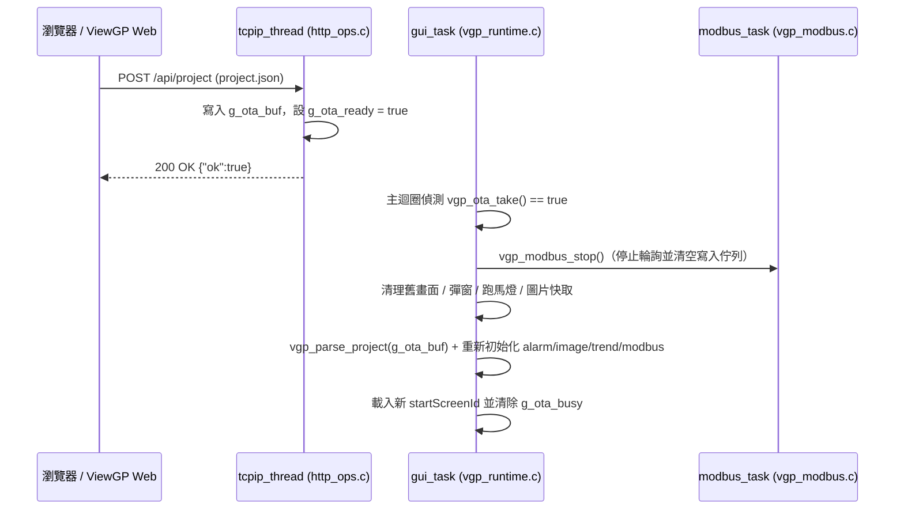

# P3 專案規模上限與現場維運開發規格書（EGM Spec）

| 項目 | 內容 |
| :--- | :--- |
| **文件狀態** | Implemented v1.0（ARM 編譯與靜態驗證通過，待實機 HTTP 測試） |
| **適用專案** | `pi-zero-w-ucos2-wifi`（Raspberry Pi Zero W / Zero 2 W，µC/OS-II V2.93.01 + LVGL 9.4.0 + lwIP 2.2.1） |
| **上游規格來源** | `InfoSys_ViewGP_Web` 匯出之 `project.json` 與現場監控維運需求 |
| **涵蓋範圍（P3）** | ① 擴大專案靜態容量上限與記憶體池（畫面／變數／元件／設備／警報／資產／`LV_MEM_SIZE`／`BOOTCFG_MAX_BYTES`）　② 內建輕量 HTTP 維運伺服器（Port 8080）：即時系統診斷 API、警報紀錄匯出 API、免拔卡熱更新 `project.json`（含內建網頁上傳介面）　③ 執行期安全熱重載引擎（`vgp_runtime_reload`） |
| **編譯與記憶體約束** | Freestanding C11（`-nostdlib -Wall -Wextra -Werror -Wstrict-prototypes -Wmissing-prototypes -DLV_DISABLE_API_MAPPING`）；總 RAM 映像須低於 `linker.ld` 之 16 MiB（目前 5.48 MiB，P3 擴充後預估 ~10.3 MiB，保留 > 5.5 MiB 餘裕） |

---

## 1. 背景、目標與非目標（Scope & Non-Goals）

### 1.1 背景與目標
P0–P2 已完成工業監控核心、全部 22 種 HMI 元件與高還原度外觀。進入實際現場部署時，仍有兩項維運痛點：
1. **專案規模限制**：目前上限為 16 畫面、128 變數、256 元件、8 台設備與 2 MiB `initramfs`，較複雜的多頁產線專案容易觸頂。
2. **更新與查修不便**：修改 `project.json` 須關機拔插 MicroSD 卡，且無遠端檢視系統健康度、Modbus 錯誤與警報紀錄的管道。

P3 目標為全面拉高專案規模上限，並在不增加 RTOS 任務的前提下，於 lwIP `tcpip_thread` 內建輕量 **HTTP 維運與熱更新伺服器（Port 8080）**，讓現場工程師透過瀏覽器或腳本即可一鍵推送新 `project.json` 即時熱重載、檢視即時診斷與匯出警報清單。

### 1.2 明確非目標（Non-Goals）
- **不實作 Bare-Metal SD 卡 FAT32 寫入驅動（EMMC/SDHost + FATFS）**：工業現場無預警斷電時直接寫入 FAT32 易造成檔案系統損毀；HTTP 熱更新將新專案載入 RAM 立即生效（重開機後回到 SD 卡基準版本），需要永久固化時再更新 SD 卡。
- **不實作 HTTPS / TLS 或多使用者登入系統**：維持內網單機工業設備定位（與上游 `InfoSys_ViewGP_Web` 單人內網安全模型一致）；HTTP 伺服器僅監聽區域網路 Wi-Fi 介面。
- **不啟用 lwIP Socket / Netconn**：延續 Raw TCP API 架構（`LWIP_SOCKET=0`），節省 RAM 與任務數。

---

## 2. 專案容量上限擴充與記憶體預算（Scale Limits & Memory Budget）

### 2.1 容量常數升級表

| 常數 / 設定 | 檔案 | P2 現況 | P3 升級值 | 說明 |
| :--- | :--- | :---: | :---: | :--- |
| `VGP_MAX_SCREENS` | `vgp_model.h` | `16` | **`32`** | 支援多達 32 個畫面／彈窗／母版 |
| `VGP_MAX_VARIABLES` | `vgp_model.h` | `128` | **`256`** | 支援 256 個內部／Modbus 標籤 |
| `VGP_MAX_TOTAL_ELEMENTS` | `vgp_model.h` | `256` | **`768`** | 支援全專案 768 個 HMI 元件 |
| `VGP_MAX_DEVICES` | `vgp_model.h` | `8` | **`16`** | 支援最多 16 台 Modbus 設備 |
| `VGP_MAX_ASSETS` | `vgp_model.h` | `16` | **`32`** | 支援 32 張 Base64 圖片資產 |
| `VGP_MAX_TRENDS` | `vgp_model.h` | `8` | **`16`** | 支援 16 組背景趨勢採樣緩衝 |
| `VGP_MAX_ALARM_AREAS` | `vgp_model.h` | `16` | **`32`** | 支援 32 個 Word 警報區（最多 512 條位元警報） |
| `VGP_MAX_LOCAL_ALARM_RULES` | `vgp_model.h` | `64` | **`128`** | 支援 128 條元件級門檻警報規則 |
| `VGP_MAX_ALARM_EVENTS` | `vgp_model.h` | `64` | **`128`** | RAM 警報歷史環形池加倍至 128 筆 |
| `LV_MEM_SIZE` | `lv_conf.h` | `2 MiB` | **`4 MiB`** | 支援更多畫面物件與解碼圖片快取 |
| `BOOTCFG_MAX_BYTES` | `bootcfg.h` | `2 MiB` | **`8 MiB`** | SD 卡 `initramfs` 可載入最大 8 MiB `project.json` |
| `MEMP_NUM_TCP_PCB` | `net/lwipopts.h` | `16` | **`24`** | 容納 16 台 Modbus TCP + Echo + HTTP 連線 |
| `MEMP_NUM_TCP_PCB_LISTEN` | `net/lwipopts.h` | `2` | **`4`** | 容納 Echo 5001 + HTTP 8080 監聽 |

### 2.2 靜態 RAM 預算評估（`linker.ld` 上限 16 MiB）
- P2 現有映像（`.text + .rodata + .data + .bss + .stacks`）：`5.48 MiB`
- 資料結構擴大（`vgp_project_t`、`g_events`、`g_trends`、`g_dev_sorted_vars`）：`+0.90 MiB`
- `LV_MEM_SIZE`（`2 MiB → 4 MiB`）：`+2.00 MiB`
- HTTP 熱更新緩衝區（`VGP_OTA_MAX_BYTES = 2 MiB` 靜態 `.bss`）：`+2.00 MiB`
- **P3 預估總計**：`~10.38 MiB`（仍保留 **~5.6 MiB** 安全餘裕，遠低於 16 MiB 上限）。

---

## 3. 輕量 HTTP 維運與熱更新伺服器規格（`net/http_ops.h` / `net/http_ops.c`）

### 3.1 執行緒模型與併發安全
- **監聽埠**：TCP Port `8080`，於 `net/network.c` 之 `add_interface()`（執行於 `tcpip_thread`）內呼叫 `http_ops_init()` 綁定與監聽（`tcp_listen_with_backlog(pcb, 4)`）。
- **零額外任務**：所有請求解析、回應傳送與 `POST` body 累積皆透過 lwIP Raw TCP 回呼於 `tcpip_thread` 完成。
- **單一上傳鎖定（Upload Guard）**：同一時間僅允許一個 `POST /api/project` 寫入 `g_ota_buf[VGP_OTA_MAX_BYTES]`；若前一次熱重載尚未被 `gui_task` 消費完成，第二個上傳請求回傳 `409 Conflict`，確保無資料競態。

### 3.2 端點規格（REST API + 內建網頁）

| 方法與路徑 | 用途 | 回應格式 |
| :--- | :--- | :--- |
| **`GET /`** | 內建輕量維運網頁（HTML+JS，無外部 CDN 依賴） | `200 OK` (`text/html; charset=utf-8`)：顯示即時狀態、Modbus 設備表、警報列表，並提供選擇 `project.json` 一鍵熱更新按鈕 |
| **`GET /api/status`** | 取得系統、Wi-Fi、NTP、LVGL、USB 與 Modbus 即時診斷 | `200 OK` (`application/json`)：`{platform, uptimeSec, ntpSynced, localTime, project:{id,name,screens,elements,variables}, lvglHeapFree, usb:{state,keys,mouse}, activeAlarms, devices:[{id,name,state,errorCount,lastError}]}` |
| **`GET /api/alarms`** | 匯出目前 RAM 內全部警報紀錄（作用中與歷史） | `200 OK` (`application/json`)：`{total, active, events:[{raisedAt, clearedAt, severity, group, message, ack}]}` |
| **`POST /api/project`** | 上傳新的 `project.json` 並觸發免重開機熱重載 | 檢查 `Content-Length`（`> 0 && <= 2 MiB`）與開頭 `{`；完成後設 `g_ota_pending = true` 並回傳 `200 OK {"ok":true,"bytes":N}`；超限回 `413`、格式錯誤回 `400`、忙碌回 `409` |
| 其他路徑 | 未知路由 | `404 Not Found` |

### 3.3 HTTP 分段接收與回應傳送細節
- **請求解析**：支援標準 HTTP/1.1 標頭分段抵達，解析請求行（Method + Path）與不分大小寫之 `Content-Length:` 標頭，定位 `\r\n\r\n` 標頭結尾。
- **長回應分塊傳送**：`GET /api/alarms` 與 `GET /` 可能大於單次 `tcp_sndbuf()`，連線狀態機保存 `tx_buf` 與 `tx_sent` 偏移，並透過 `tcp_sent()` 回呼續傳剩餘位元組，傳完後安全 `tcp_close()`。
- **連線逾時清理**：設定 `tcp_poll(pcb, http_poll_cb, 10)`（約 5 秒一次），超過 30 秒無活動之閒置連線自動關閉釋放 PCB。

---

## 4. 執行期熱重載規格（`vgp_runtime_reload()` 與 `vgp_modbus_stop()`）

### 4.1 跨執行緒交接流程

### 4.2 資源清理不變量（零記憶體洩漏）
1. **停止 Modbus 並等待空閒**：`vgp_modbus_stop()` 設定 `g_started = false` 並等待 `g_poll_in_progress == false`（最多 500ms），確保 `modbus_task` 不再讀寫 `g_proj`。
2. **清理 LVGL 物件**：
   - 釋放 `g_momentary_var_idx`、取消 `g_edit_el`、清空 `g_kbd_group`。
   - 關閉 `g_popup_layer`、刪除 `g_ticker_bar`（並設為 `NULL`）。
   - 建立臨時空畫面並 `lv_screen_load()`，再逐一 `lv_obj_delete()` 舊 `g_proj.screens[i].lv_screen`（避免刪除當前活動畫面導致 LVGL 斷言失敗！）。
   - `vgp_image_init(&g_proj)` 會自動 `lv_free()` 所有舊的已解碼圖片緩衝區。
3. **JSON 解析失敗防呆**：若新上傳的 `project.json` 無法解析（`num_screens == 0`），於底部狀態列提示 `OTA parse failed` 而不崩潰。
4. **狀態診斷資料唯讀快照**：於 `vgp_runtime.h` 提供 `vgp_runtime_format_status_json()` 與 `vgp_runtime_format_alarms_json()`，透過短臨界區安全讀取變數與警報事件供 `http_ops.c` 輸出（絕不從 `tcpip_thread` 觸碰任何 LVGL API）。

---

## 5. 檔案變更清單與實作順序

| 檔案 | 類型 | 說明 |
| :--- | :---: | :--- |
| `vgp_model.h` / `lv_conf.h` / `bootcfg.h` / `net/lwipopts.h` | 修改 | 升級所有容量常數、`LV_MEM_SIZE = 4 MiB`、`BOOTCFG_MAX_BYTES = 8 MiB`、`MEMP_NUM_TCP_PCB = 24`、`MEMP_NUM_TCP_PCB_LISTEN = 4` |
| `vgp_modbus.h` / `vgp_modbus.c` | 修改 | 新增 `vgp_modbus_stop()` 安全停機同步與 `g_poll_in_progress` 旗標 |
| `vgp_runtime.h` / `vgp_runtime.c` | 修改 | 新增 `vgp_runtime_reload()`（安全清理舊 LVGL 畫面與資源）及唯讀 JSON 診斷／警報匯出函式 |
| `net/http_ops.h` / `net/http_ops.c` | 新增 | lwIP Raw TCP HTTP 伺服器（Port 8080）、`GET /`、`/api/status`、`/api/alarms`、`POST /api/project` 與 2 MiB OTA 緩衝 |
| `net/network.c` / `gui.c` / `Makefile` | 修改 | `add_interface()` 啟動 `http_ops_init()`、`gui_task` 主迴圈輪詢觸發 `vgp_runtime_reload()`、`Makefile` 加入 `build/http_ops.o` |

---

## 6. 驗證計畫（Verification Plan）

1. **建置與記憶體驗證**：
   - 執行 `.\tools\build-and-stage.ps1`，確認 0 warnings / 0 errors（`-Werror`）、總 RAM 映像低於 16 MiB（`verify-build.ps1` 檢查所有堆疊 `<= 0x01000000`）、`verify-sdcard.ps1` 全數 PASS。
2. **實機 HTTP 維運與熱更新測試**：
   - Pi Zero 連上 Wi-Fi 後，於瀏覽器開啟 `http://<Pi-IP>:8080/`，確認顯示系統狀態與 Modbus 設備表。
   - 呼叫 `curl http://<Pi-IP>:8080/api/status` 與 `/api/alarms` 驗證合法 JSON 輸出。
   - 透過網頁或 `curl -X POST --data-binary @project.json http://<Pi-IP>:8080/api/project` 推送修改後的 `project.json`，驗證 HDMI 畫面免重開機立即切換至新專案、連續熱更新 3 次以上 `lvglHeapFree` 無明顯洩漏。
