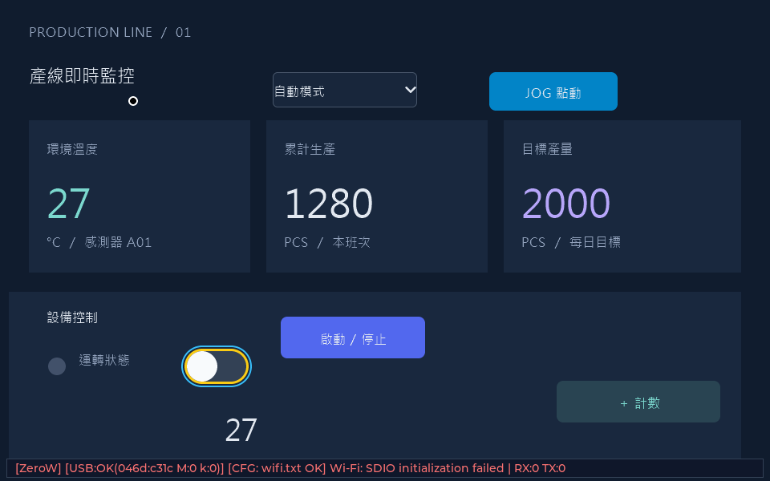
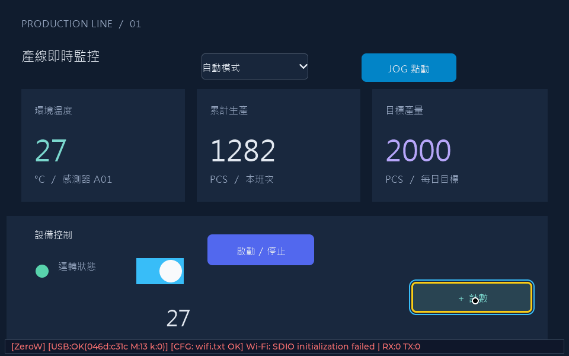
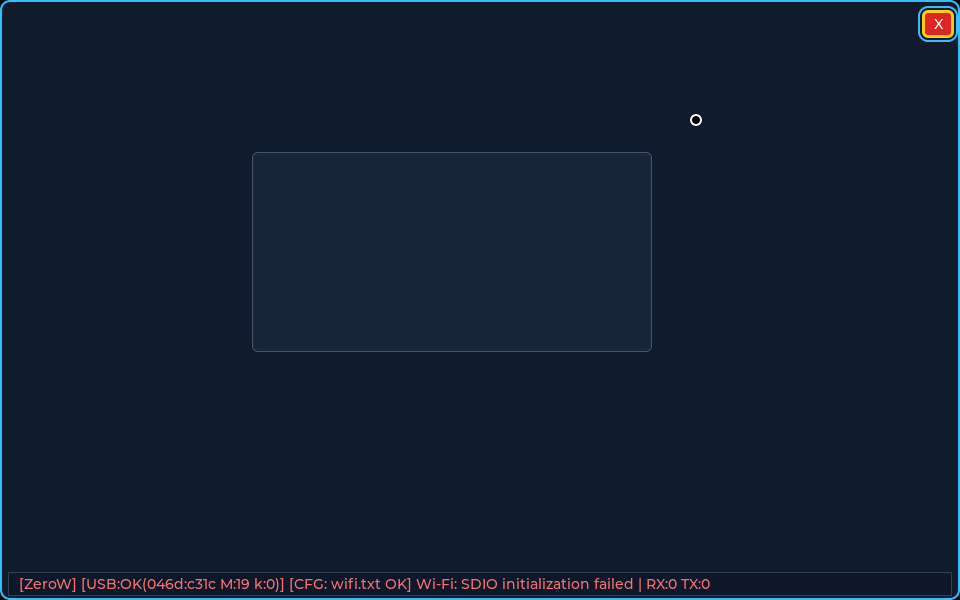
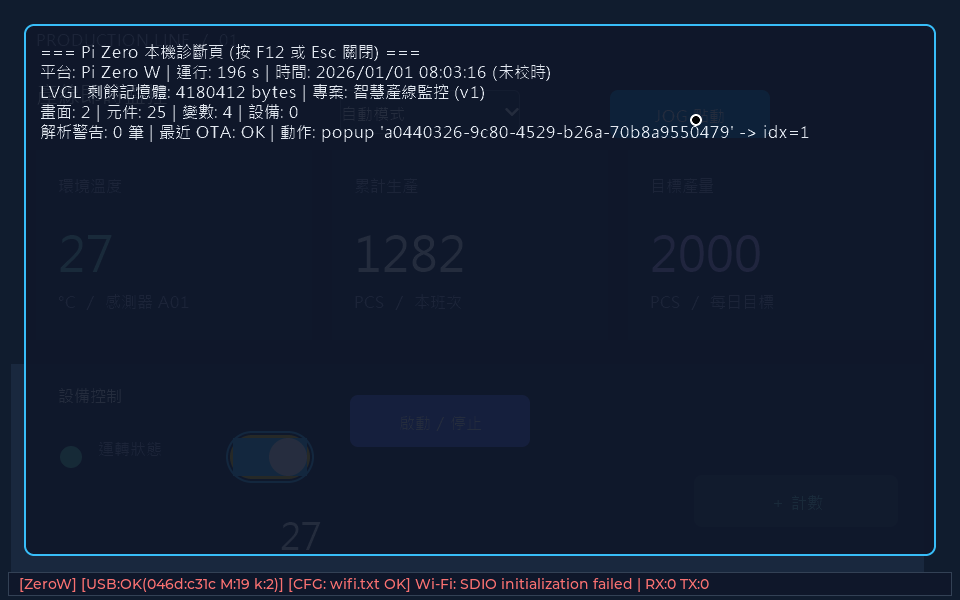
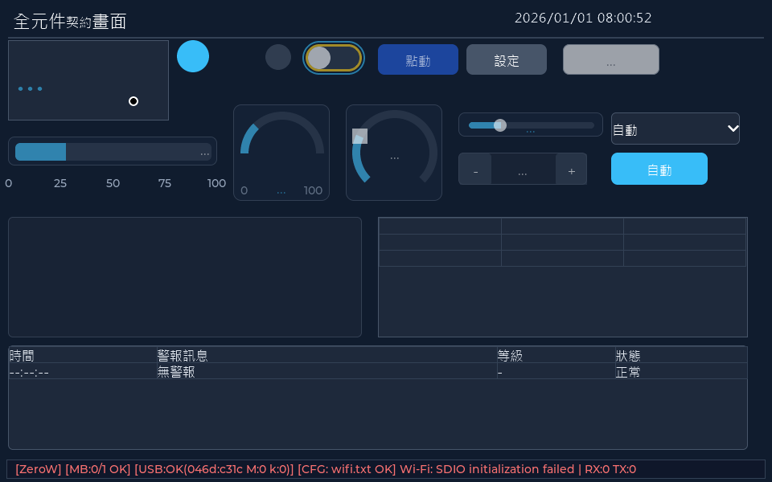

# Raspberry Pi Zero W ViewGP HMI 監控系統操作說明書

本說明書介紹如何使用 **Raspberry Pi Zero W 裸機 HMI 監控系統**（µC/OS-II V2.93.01 + LVGL 9.4.0 + lwIP 2.2.1）與 **`InfoSys_ViewGP_Web` 網頁設計器** 完成畫面設計、部署上機、現場滑鼠／鍵盤操作、對話視窗切換、本機診斷與遠端熱更新。

---

## 1. 系統總覽與硬體接線

### 1.1 硬體需求
- **主機板**：Raspberry Pi Zero W（BCM2835，512 MiB RAM）
- **儲存媒體**：MicroSD 卡（FAT32 格式，建議 8 GB–32 GB）
- **顯示螢幕**：HDMI 螢幕（透過 Mini-HDMI 轉接線，支援 `640×480` 至 `1920×1200`）
- **輸入裝置**：USB HID 鍵盤、USB HID 滑鼠（可直連 Micro-USB OTG，或透過單層 USB Hub 同時連接鍵盤與滑鼠）
- **電源**：5V / 2A Micro-USB 電源（接至 `PWR IN` 孔）
- **選配通訊**：Wi-Fi 2.4 GHz（Modbus TCP、SNTP 網路對時、HTTP 8080 遠端維運）或 GPIO14/15 UART0 外接 RS-485（Modbus RTU）

### 1.2 MicroSD 卡必要檔案
請將專案 `sdcard/` 目錄內所有檔案複製到 MicroSD 卡根目錄：

| 檔案 | 說明 |
|---|---|
| `bootcode.bin`、`start.elf`、`fixup.dat` | Raspberry Pi GPU 開機韌體 |
| `kernel.img` | µC/OS-II + LVGL + ViewGP 執行核心 |
| `config.txt` | HDMI 解析度設定與 `initramfs wifi.txt,project.json 0x02000000` 預載設定 |
| `project.json` | 由 `InfoSys_ViewGP_Web` 匯出的 HMI 監控畫面專案檔 |
| `wifi.txt` | Wi-Fi 連線、時區、SNTP 對時與遠端維運認證設定 |

### 1.3 `wifi.txt` 設定範例
```ini
ssid=Your_WiFi_SSID
password=Your_WiFi_Password
country=TW

# 時區（台灣 UTC+8）與 NTP 伺服器
tz_offset=8
ntp_server=pool.ntp.org

# HTTP 8080 遠端熱更新安全權杖（強烈建議現場設定）
ops_token=ChangeMe_SecretToken
# 若不開放遠端 API，設為 0 可完全關閉 Port 8080
ops_http=1
```

> [!TIP]
> **調整螢幕解析度**：開啟 MicroSD 卡根目錄的 `config.txt`，修改 `hdmi_group`、`hdmi_mode` 與 `framebuffer_width` / `framebuffer_height`（例如 `800×600`、`1024×768`、`1920×1080`），核心開機時會自動偵測解析度並等比例縮放置中畫面，**無須重新編譯**。

---

## 2. 主畫面與狀態列說明

插入 MicroSD 卡並接通電源後，系統會在數秒內直接進入 `project.json` 設定的起始畫面（下圖以範例專案「智慧產線監控」為例）：



### 畫面區塊說明
1. **上方控制列**：包含畫面標題、模式「下拉選單（`dropdown`）」與「`JOG 點動`」彈窗按鈕。
2. **中段數值卡片**：以大尺寸字體即時顯示溫度（`27 °C`）、累計生產（`1280 PCS`）與目標產量（`2000 PCS`）。
3. **下方設備控制面板**：包含運轉狀態指示燈（灰＝停止／綠＝運轉）、運轉開關（`switch`）、「`啟動 / 停止`」切換按鈕與「`+ 計數`」遞增按鈕。
4. **滑鼠游標與鍵盤焦點框**：
   - 偵測到 USB 滑鼠時會顯示**黑底白框圓點游標**，可直接移動與左鍵點擊元件。
   - 使用鍵盤切換焦點時，當前選取的元件會亮起**黃色／藍色外框**。
5. **最底部系統狀態列**：即時回報硬體與連線狀態，格式如下：
   - `[ZeroW]`：硬體平台識別（Pi Zero W / Zero 2 W）。
   - `[NTP]`：完成網路對時後顯示。
   - `[MB:x/y OK]`：若專案有設定 Modbus 設備，顯示目前正常連線台數／總台數。
   - `[USB:OK(VID:PID M:封包數 k:按鍵數)]`：USB 裝置列舉狀態，移動滑鼠時 `M:` 會即時遞增，按鍵盤時 `k:` 會即時遞增。
   - `[CFG: wifi.txt OK]`：`wifi.txt` 載入狀態與目前 Wi-Fi IP／收發封包計數。

---

## 3. 互動操作方式（USB 滑鼠與鍵盤）

本系統同時支援 **USB 滑鼠直接點擊** 與 **USB 鍵盤全功能操作**。下圖展示點擊「`啟動 / 停止`」與連續兩次點擊「`+ 計數`」後的即時回饋（運轉指示燈轉為綠色、運轉開關撥至右側開啟狀態、累計生產由 `1280` 更新為 `1282`）：



### 3.1 USB 滑鼠操作
| 操作 | 作用 |
|---|---|
| 移動滑鼠 | 移動畫面上的白框圓點游標 |
| 左鍵單擊按鈕 / 開關 / 警報表 | 執行按鈕動作、切換開關、或確認（ACK）警報 |
| 左鍵點擊並拖曳滑桿 / 圓弧旋鈕 | 調整數值，放開左鍵時提交寫入變數／Modbus |
| 左鍵點擊微調輸入（`spinbox`）的 `-` / `+` | 依步距遞減／遞增數值 |
| 左鍵點擊下拉選單（`dropdown`） | 展開中文選項清單並點選切換 |
| 左鍵長按寸動按鈕（`momentary`） | 按住期間寫入 `true`，放開或移開游標即自動回復 `false` |

### 3.2 USB 鍵盤快捷鍵對照表
| 按鍵 | 作用 |
|---|---|
| `Tab` / `→` / `↓` | 切換焦點至下一個可操作元件 |
| `Shift+Tab` / `←` / `↑` | 切換焦點至上一個可操作元件 |
| `Enter` / `空白鍵` | 觸發目前聚焦的按鈕、開關、下拉選單，或提交輸入框數值 |
| `0`–`9`、`.`、`-`、`Backspace` | 當焦點在數值輸入框（`input`）時直接鍵入數字並以 `Enter` 確認 |
| `+` / `-` | 當焦點在微調框（`spinbox`）、滑桿（`slider`）或圓弧旋鈕（`arc`）時依步距增減 |
| `Esc` | 依序取消輸入編輯、關閉彈出對話視窗，或關閉 `F12` 診斷頁 |
| `F12` | 開啟／關閉 **Pi Zero 本機診斷頁** |

---

## 4. 彈出對話視窗（Popup / Dialog）操作

當點擊動作設定為 `popup` 或 `openDialog` 的按鈕（例如主畫面右上方的「`JOG 點動`」按鈕），系統會以半透明深色遮罩開啟對應的對話視窗（下圖為「畫面 2」趨勢圖彈窗）：



### 關閉對話視窗的三種方式
1. **點擊右上角紅色 `[X]` 按鈕**（即使設計器中未於彈窗內放置「關閉對話盒」按鈕，Pi Zero 仍會自動提供安全關閉鈕）。
2. **點擊對話視窗外部的半透明黑色背景**。
3. **按下鍵盤 `Esc` 鍵**（或在焦點位於 `[X]` 按鈕時按 `Enter`）。

---

## 5. 本機診斷頁（`F12`）與遠端維運

### 5.1 本機診斷頁（按 `F12`）
在現場排錯或點檢時，隨時按下鍵盤 **`F12`** 即可疊加顯示系統即時診斷面板（再次按 `F12` 或 `Esc` 關閉）：



診斷面板顯示的關鍵資訊包括：
- **平台與運行時間**：確認主機板型號、開機秒數與 SNTP 校時狀態（`NTP已同步` / `未校時`）。
- **LVGL 剩餘記憶體**：即時監控 4 MiB LVGL 動態記憶體餘量，確認長時間運行無洩漏。
- **專案摘要**：專案名稱、`schemaVersion`、畫面數、元件數、變數數、Modbus 設備數。
- **解析警告與最近 OTA／動作記錄**：若 `project.json` 有欄位截斷、不支援屬性或遠端熱更新失敗，會於此直接列出具體訊息。
- **Modbus 設備連線清單**：列出每台 PLC 的 `CONNECTED` / `CONNECTING` / `ERROR` 狀態與錯誤計數。

### 5.2 遠端維運（HTTP Port 8080）
Pi Zero 連上 Wi-Fi 後，同網段電腦可使用瀏覽器或 `InfoSys_ViewGP_Web` 設計器存取：
- `GET http://<Pi-IP>:8080/`：內建簡易維運網頁（查看狀態、警報與上傳新 `project.json`）。
- `GET http://<Pi-IP>:8080/api/status`：取得 JSON 格式的系統健康度、Modbus 狀態與解析警告。
- `GET http://<Pi-IP>:8080/api/alarms`：取得目前觸發中與歷史警報清單。
- `POST http://<Pi-IP>:8080/api/project`（需於 Header 帶入 `X-Ops-Token: <ops_token>`）：**原子熱重載**新專案；若上傳檔案損毀或超限會自動回滾並維持原畫面不中斷。

---

## 6. 22 種支援元件展示與資料品質判讀

系統完整支援 `InfoSys_ViewGP_Web` 全部 **22 種 HMI 元件**。下圖為全元件契約測試畫面（`tests/fixtures/contract_full.json`）在 Pi Zero 核心上的實際渲染效果：



畫面中包含：
- **繪圖與靜態元件**：矩形、圓形、直線（對齊邊框色與粗細）、圖片（Base64 PNG/JPEG）、刻度尺（支援 `scaleShowAxis` 隱藏軸線）、空白格線表格（均分欄寬）。
- **顯示元件**：文字、大數值、時間/日期、指示燈、多狀態指示燈、長條顯示卡片（含標題、最小/最大刻度與即時數值）、180° 半圓儀表卡片、即時趨勢圖、警報清單。
- **互動與編輯元件**：按鈕（含寸動與彈窗）、撥桿開關、數值輸入、滑桿卡片、圓弧旋鈕卡片、微調輸入（`-/+`）、中文下拉選單。

### 通訊失效與資料品質可視化
當變數綁定 Modbus 設備時，畫面會依通訊品質自動提示，**絕不將過期舊值偽裝為正常數據**：
- **等待首次連線（`WAITING`）**：數值顯示 `...`（如上圖未連上實體 PLC 時的狀態），元件降為半透明並鎖定寫入。
- **通訊斷線或逾時（`BAD`）**：數值顯示 `---`、多狀態燈顯示 `BAD`、元件外框亮起**紅色警示邊框**並鎖定寫入；既有警報維持凍結狀態避免誤觸發或誤復歸，待 PLC 恢復通訊後自動解除紅框並恢復顯示。

---

## 7. 從 Web 設計器部署至 Pi Zero 步驟

1. 在 `InfoSys_ViewGP_Web` 設計器完成畫面編輯後，點選上方選單 **「專案 → 部署至 Pi Zero」**。
2. 檢視**匯出前自動檢查報告**：
   - 確認 **阻擋錯誤（Errors）為 0**（例如畫面數 ≤ 32、變數 ≤ 256、元件 ≤ 768、設備 ≤ 16、圖片資產 ≤ 32）。
   - 若有 **警告（Warnings）**（例如超長中文字串、WebP 圖片或 Pi Zero 不支援的斜體／Hover 屬性），依畫面上的修正建議調整。
   - 若專案有使用畫面繼承（`parentScreenId` / `inheritsScreenId`），匯出時會自動扁平化展開，確保 Pi Zero 呈現與設計器一致。
3. **建議兩階段更新**：
   - **步驟 A（Wi-Fi 熱重載試跑）**：於對話盒輸入 Pi Zero 的 IP 與 `ops_token`，點選「**立即推送熱重載**」線上驗證畫面與 PLC 通訊。
   - **步驟 B（寫入 MicroSD 卡永久生效）**：確認無誤後點選「**下載 project.json (SD 卡部署)**」，將原 SD 卡中的 `project.json` 備份為 `project.json.bak`，再覆寫新的 `project.json` 重新開機。

---

## 8. Windows 開發機模擬器操作

若尚未連接實體 Pi Zero，可直接在 Windows 開發機執行互動模擬器，直接以真正的 ARM1176 核心（`build/kernel.elf`）載入 `sdcard/project.json` 進行畫面與滑鼠／鍵盤測試：

```powershell
.\tools\run-simulator.ps1
```

模擬器視窗支援：
- 直接以 Windows 滑鼠移動、點擊按鈕／開關／滑桿／下拉選單／對話視窗。
- 直接以鍵盤 `Tab` / 方向鍵 / `Enter` / `Esc` / `F12` 進行操作與診斷。
- 視窗上方工具列即時顯示 µC/OS-II `OSTime`、GUI 畫面張數（`GUI_Frames`）與模擬 USB 鍵鼠事件計數。

---

## 9. 常見問題排解（FAQ）

| 問題現象 | 排查與解決方式 |
|---|---|
| **開機無畫面或解析度異常** | 確認 Mini-HDMI 接頭與螢幕輸入源；檢查 `config.txt` 的 `hdmi_group` / `hdmi_mode` / `framebuffer_width` / `framebuffer_height` 是否相容該螢幕。 |
| **開機顯示紅色錯誤訊息且退回內建儀表板** | 代表 `project.json` 格式錯誤、`schemaVersion` 不為 1 或超過 8 MiB；請回到設計器使用「部署至 Pi Zero」重新驗證匯出。 |
| **USB 滑鼠或鍵盤無反應** | 觀察底部狀態列 `USB:` 欄位；若透過 USB Hub 連接請確認為單層 Hub 且供電充足。確認 `kernel.img` 已更新為最新版（支援 DWC2 Split Transactions）。 |
| **數值顯示 `---` 或 `...` 且無法操作** | 按 `F12` 檢查 `[Modbus 設備狀態]`，確認 Wi-Fi IP、PLC IP／Port／Unit ID 與網路連通性。 |
| **更新 `project.json` 後想回復舊版** | 若是 Wi-Fi 熱重載異常，直接斷電重開即會載回 MicroSD 卡原版；若是 SD 卡更新異常，將 `project.json.bak` 改回 `project.json` 即可。 |

---

### 延伸閱讀
- 完整功能支援矩陣：[VIEWGP.md](../VIEWGP.md)
- 硬體實測矩陣與支援聲明：[HARDWARE_TEST_MATRIX.md](HARDWARE_TEST_MATRIX.md)
- 現場部署、備份與回復 SOP：[DEPLOYMENT_AND_RECOVERY_SOP.md](DEPLOYMENT_AND_RECOVERY_SOP.md)
